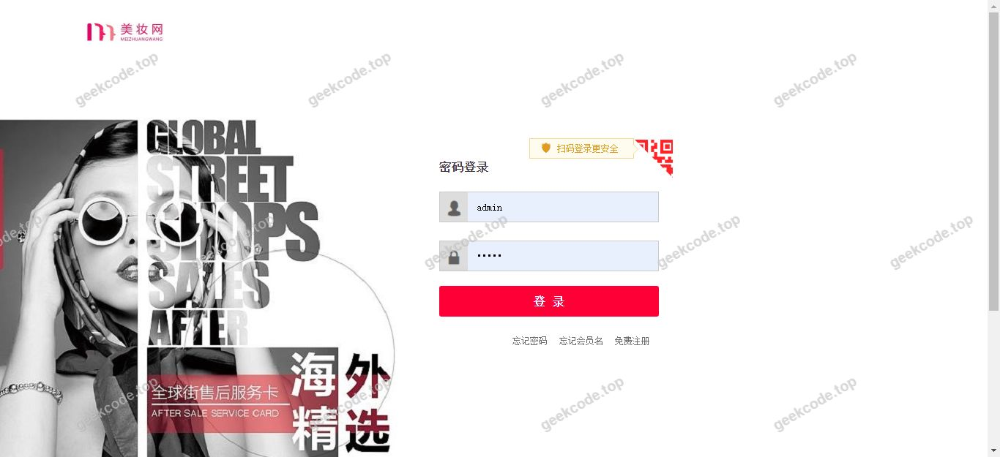
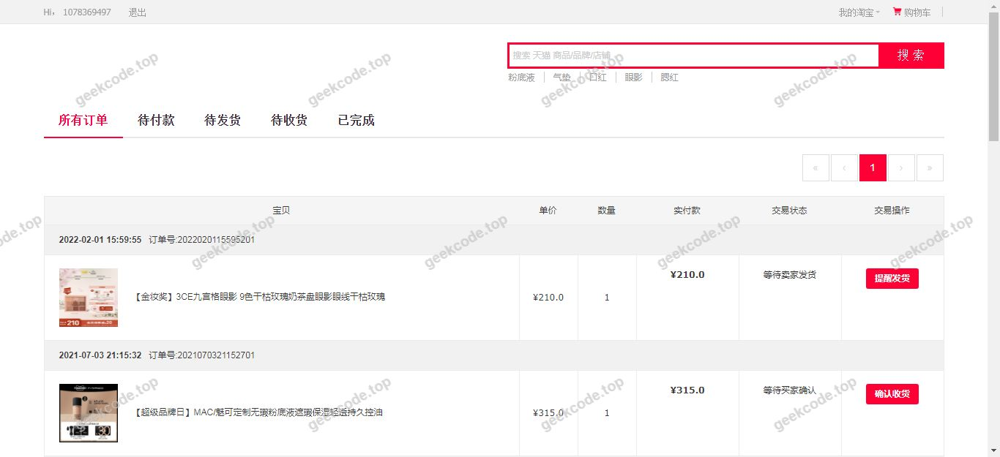
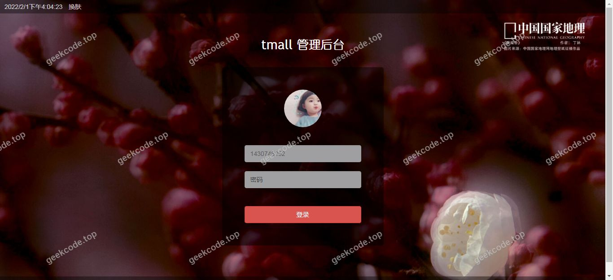
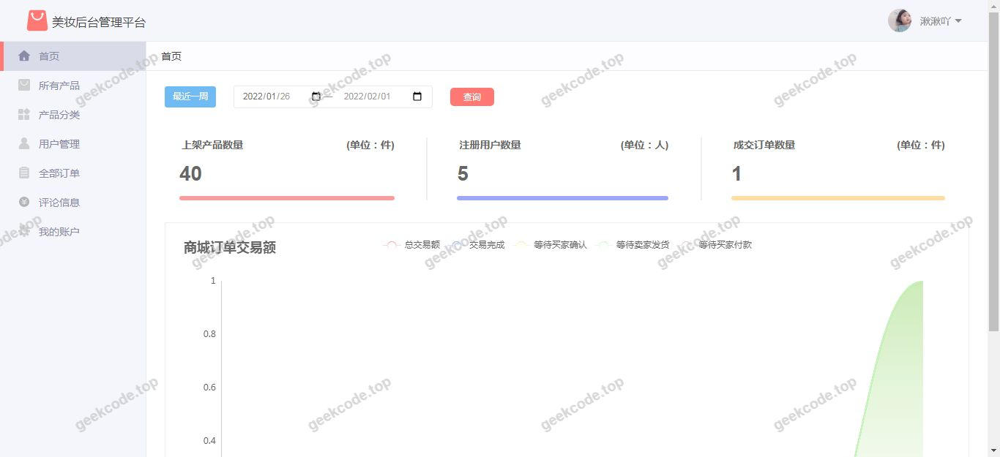
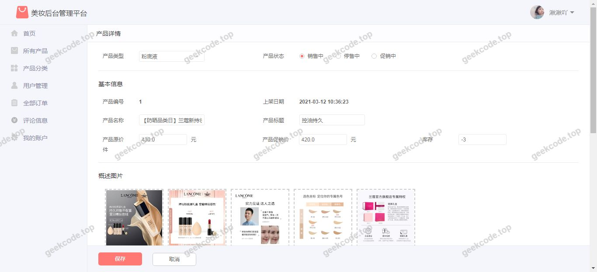

# java精品项目-基于ssm的化妆品商城系统

> 🎓 **计算机毕业设计 · java精品项目-基于ssm的化妆品商城系统**
>
> 本仓库只放**项目介绍 + 运行截图**（截图是站点带水印的原图，存在仓库 `images/` 里）。
>
> 👉 **完整可运行源码 / 数据库脚本 / 部署文档：[点我获取](https://geekcode.top/archives/java%E7%B2%BE%E5%93%81%E9%A1%B9%E7%9B%AE-%E5%9F%BA%E4%BA%8Essm%E7%9A%84%E5%8C%96%E5%A6%86%E5%93%81%E5%95%86%E5%9F%8E%E7%B3%BB%E7%BB%9F?utm_source=github)**
>
> 💬 咨询微信：**ir9372**　|　🌐 更多项目：[极客代码 geekcode.top](https://geekcode.top/?utm_source=github)
>
> 📌 项目详情页：<https://geekcode.top/archives/java%E7%B2%BE%E5%93%81%E9%A1%B9%E7%9B%AE-%E5%9F%BA%E4%BA%8Essm%E7%9A%84%E5%8C%96%E5%A6%86%E5%93%81%E5%95%86%E5%9F%8E%E7%B3%BB%E7%BB%9F?utm_source=github>

<table><td width="230" align="center"> <b>扫码加微信 ir9372</b></td><td valign="middle">📦 源码 = 项目介绍 + 全部运行截图 + 数据库 + 部署文档 👉 点上方任意截图，直接跳到 <b>极客代码 geekcode.top</b> 详情页</td></table>

---

<h1>java精品项目-基于ssm的化妆品商城系统</h1>
<h2>项目概述</h2>

本项目名为“java精品项目-基于ssm的化妆品商城系统”，是一个基于Java Web技术栈构建的电子商务平台原型。尽管项目名称中提及SSM（Spring, Spring MVC, MyBatis），但实际核心架构采用Spring Boot框架，结合MyBatis作为持久层框架，并使用Druid作为数据库连接池。该项目主要面向化妆品销售场景，旨在提供一个基础的在线购物环境。根据提供的配置信息，该项目未定义明确的前台导航菜单、个人中心菜单或后台路由，且标记为无前台和无后台功能模块。因此，本项目的当前状态更偏向于一个基础的技术验证原型或后端服务骨架，而非完整的可交互商业系统。其适用人群主要为计算机专业学生进行毕业设计参考，用于学习Spring Boot与MyBatis整合及JSP页面渲染机制。

<h2>技术架构</h2>
<h3>前后端架构描述</h3>

本项目采用传统的MVC设计模式，具体实现如下：

<ol>
<li><strong>表现层</strong>：使用JSP（JavaServer Pages）作为视图模板引擎。通过引入<code>tomcat-embed-jasper</code>和<code>jstl</code>标签库，支持在服务器端动态生成HTML页面。同时依赖<code>taglibs-standard-impl</code>以提供标准的JSP标签实现。</li>
<li><strong>控制层</strong>：基于Spring Boot框架的<code>spring-boot-starter-web</code>模块，利用内置的Tomcat容器处理HTTP请求。虽然未提供具体的Controller代码，但架构上依赖Spring MVC机制进行请求分发。</li>
<li><strong>业务逻辑层</strong>：由Spring Boot自动装配管理Bean的生命周期和依赖注入。</li>
<li><strong>数据访问层</strong>：采用MyBatis框架，通过<code>mybatis-spring-boot-starter</code>实现与Spring Boot的快速集成。SQL语句映射文件与Java接口分离，便于维护。</li>
<li><strong>数据库连接</strong>：使用阿里巴巴开源的Druid连接池（<code>druid</code>依赖），负责管理与MySQL数据库的物理连接，提供高效的资源复用和监控能力。</li>
</ol>
<h3>数据库设计要点</h3>
<ul>
<li><strong>数据库类型</strong>：MySQL。</li>
<li><strong>驱动依赖</strong>：<code>mysql-connector-java</code>。</li>
<li><strong>设计现状</strong>：由于提供的上下文仅包含技术依赖列表，未包含具体的SQL建表脚本或实体类定义，因此无法确定具体的表结构、字段约束及关系模型。通常此类商城系统会包含用户表、商品表、订单表等，但基于现有信息，具体Schema设计不可知。</li>
</ul>
<h3>核心技术选型理由</h3>
<ul>
<li><strong>Spring Boot</strong>：选择Spring Boot是为了简化Spring应用的初始搭建以及开发过程，提供自动配置和内嵌服务器，适合快速构建独立运行的Java应用。</li>
<li><strong>MyBatis</strong>：相比Hibernate，MyBatis提供了更灵活的SQL控制能力，适合需要精细优化查询性能的电商场景，且与Spring Boot集成成熟。</li>
<li><strong>Druid</strong>：选用Druid是因为其在性能、稳定性和监控方面优于传统连接池（如C3P0、DBCP），特别适合生产环境下的数据库访问管理。</li>
<li><strong>Fastjson</strong>：用于高性能的JSON序列化与反序列化，处理前后端数据交换。</li>
</ul>
<h2>功能模块</h2>

根据提供的“是否有前台: 否”、“是否有后台: 否”以及空白的菜单和路由列表，本项目在当前配置状态下<strong>不包含已实现的具体业务功能模块</strong>。

然而，从技术依赖和项目名称推断，该系统具备以下潜在的技术支撑能力，但未体现为具体的UI/UX功能：

<ol>
<li><strong>Web服务能力</strong>：能够启动HTTP服务，接收客户端请求并返回响应。</li>
<li><strong>页面渲染能力</strong>：支持JSP页面的编译与执行，能够输出动态HTML内容。</li>
<li><strong>数据持久化能力</strong>：具备连接MySQL数据库并执行CRUD操作的基础设施。</li>
<li><strong>序列化处理能力</strong>：支持Java对象与JSON格式之间的转换。</li>
</ol>

<strong>注意</strong>：由于缺乏具体的控制器（Controller）、服务（Service）和页面（JSP）代码片段，无法列出如“用户登录”、“商品浏览”、“购物车管理”、“订单提交”等具体业务功能。截图显示的“系统运行界面1-8 (front)”暗示存在前端展示页面，但鉴于文本信息明确指出“无前台导航菜单”且“是否有前台: 否”，这些界面可能仅为静态测试页或未完成的占位符，不具备完整的业务流程闭环。

<h2>用户角色与权限</h2>

根据现有信息，项目中未定义任何用户角色或权限控制机制。

<ul>
<li><strong>普通用户</strong>：无。未提供注册、登录或个人中心相关的路由和功能。</li>
<li><strong>管理员</strong>：无。未提供后台管理系统入口、路由或权限校验逻辑。</li>
</ul>

因此，<strong>根据现有信息无法确定</strong>该系统的用户角色划分及对应的权限范围。

<h2>项目特色与创新点</h2>

基于提供的源码配置和元数据，本项目的主要特点体现在技术栈的标准整合上，而非业务逻辑的创新：

<ol>
<li><strong>经典技术栈整合</strong>：展示了Spring Boot + MyBatis + Druid这一主流Java Web开发组合的配置方式，适合作为初学者理解各组件协作关系的案例。</li>
<li><strong>JSP遗留技术支持</strong>：在现代前后端分离趋势下，保留了JSP服务端渲染的实现路径（通过<code>tomcat-embed-jasper</code>），对于理解传统Java Web开发流程有一定参考价值。</li>
<li><strong>轻量级部署</strong>：利用Spring Boot的内嵌Tomcat特性，无需外部Web服务器即可独立运行，降低了部署复杂度。</li>
</ol>

<strong>局限性说明</strong>：由于缺乏具体的业务代码和完整的功能实现，本项目在商业模式、用户体验设计或算法创新方面没有体现出具体的特色。它更像是一个技术脚手架（Scaffold）而非成品软件。

<h2>部署环境</h2>

要成功运行此项目，需满足以下软件环境要求：

<ol>
<li><strong>Java开发工具包 (JDK)</strong>：</li>
</ol>
<ul>
<li>建议版本：JDK 1.8 或更高版本（取决于Spring Boot的具体版本，通常Spring Boot 2.x兼容JDK 8+）。</li>
</ul>
<ol start="2">
<li><strong>数据库服务器</strong>：</li>
</ol>
<ul>
<li>MySQL 5.7 或 MySQL 8.0。</li>
<li>需确保<code>mysql-connector-java</code>驱动版本与MySQL服务器版本兼容。</li>
</ul>
<ol start="3">
<li><strong>构建工具</strong>：</li>
</ol>
<ul>
<li>Maven 3.6+ 或 Gradle（用于解析pom.xml/build.gradle中的依赖项，如<code>spring-boot-starter</code>, <code>mybatis</code>, <code>druid</code>等）。</li>
</ul>
<ol start="4">
<li><strong>IDE（可选）</strong>：</li>
</ol>
<ul>
<li>IntelliJ IDEA 或 Eclipse（用于代码编辑和调试）。</li>
</ul>
<ol start="5">
<li><strong>浏览器</strong>：</li>
</ol>
<ul>
<li>Chrome, Firefox, Edge等现代浏览器，用于访问JSP生成的前端页面。</li>
</ul>

<strong>启动步骤简述</strong>：

<ol>
<li>配置<code>application.yml</code>或<code>application.properties</code>文件中的数据库URL、用户名和密码。</li>
<li>使用Maven命令 <code>mvn spring-boot:run</code> 或在IDE中直接运行主启动类。</li>
<li>服务启动后，访问默认端口（通常为8080）查看JSP页面。</li>
</ol>
<h2>五、技术特性</h2>
<ul>
<li>服务端模板渲染（JSP）</li>
</ul>
<h2>六、功能模块截图</h2>
<h3>前台用户端</h3>
<h4>系统运行界面1</h4>

<h4>系统运行界面2</h4>

<h4>系统运行界面3</h4>

<h4>系统运行界面4</h4>

<h4>系统运行界面5</h4>

<h4>系统运行界面6</h4>

<h4>系统运行界面7</h4>

<h4>系统运行界面8</h4>

---

## 获取完整源码

| 项目 | 说明 |
| --- | --- |
| 项目名 | java精品项目-基于ssm的化妆品商城系统 |
| 运行截图 | 本文 8 张（站点带水印原图，仓库 `images/` 目录） |
| 完整源码 | [https://geekcode.top/archives/java%E7%B2%BE%E5%93%81%E9%A1%B9%E7%9B%AE-%E5%9F%BA%E4%BA%8Essm%E7%9A%84%E5%8C%96%E5%A6%86%E5%93%81%E5%95%86%E5%9F%8E%E7%B3%BB%E7%BB%9F?utm_source=github](https://geekcode.top/archives/java%E7%B2%BE%E5%93%81%E9%A1%B9%E7%9B%AE-%E5%9F%BA%E4%BA%8Essm%E7%9A%84%E5%8C%96%E5%A6%86%E5%93%81%E5%95%86%E5%9F%8E%E7%B3%BB%E7%BB%9F?utm_source=github) |
| 咨询微信 | **ir9372**（备注：jingpin-yuanma） |
| 更多项目 | [极客代码 geekcode.top](https://geekcode.top/?utm_source=github) |

> 需要源码、部署、改配置、跑不起来等问题，加微信 ir9372 沟通，说明项目名即可。
